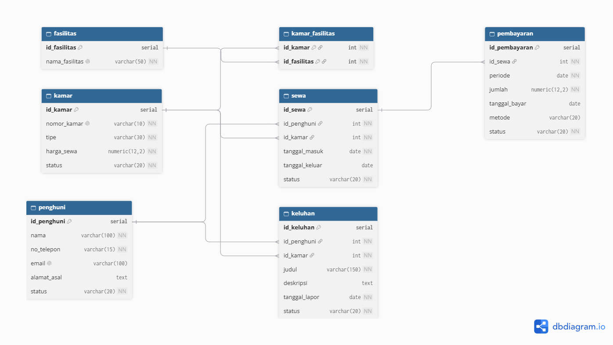

# Kos Management System API

REST API untuk membantu pengelolaan kos: data kamar, penghuni, fasilitas, sewa, pembayaran, dan keluhan. Backend dibuat dengan Python + Flask dan PostgreSQL. Frontend tidak termasuk karena bersifat opsional dalam panduan tugas.

## Fitur

- CRUD kamar, penghuni, fasilitas, sewa, pembayaran, dan keluhan.
- Pengelolaan relasi many-to-many kamar dan fasilitas.
- JSON request/response dan status HTTP.
- Validasi field sederhana serta penanganan error database.
- Health check koneksi database di `/health`.

## Teknologi

- Python 3.12+
- Flask
- PostgreSQL
- Psycopg 3
- Vercel untuk deployment

## Struktur database

Database menggunakan 7 tabel:
1. `kamar`
2. `penghuni`
3. `fasilitas`
4. `kamar_fasilitas` (tabel pivot)
5. `sewa`
6. `pembayaran`
7. `keluhan`



File `schema.dbml` dapat ditempel ke https://dbdiagram.io untuk membuat ERD. File `database.sql` berisi SQL awal proyekmu beserta contoh data. Jalankan di database kosong karena skrip tersebut menghapus tabel dengan nama yang sama sebelum membuat ulang.

## Persiapan database

1. Buat database PostgreSQL online (misalnya melalui Neon atau Supabase).
2. Buka SQL Editor pada penyedia database.
3. Jalankan isi file `database.sql`. Jalankan bagian `DROP TABLE` hanya jika database benar-benar baru atau data lama memang boleh dihapus.
4. Pastikan tabel terbentuk. Jika provider memberi URL koneksi, simpan URL tersebut secara rahasia.

## Menjalankan lokal di Windows

1. Install Python 3.12+.
2. Buka folder proyek ini di VS Code.
3. Buka terminal dan jalankan:

   ```powershell
   python -m venv .venv
   .venv\Scripts\Activate.ps1
   pip install -r requirements.txt
   Copy-Item .env.example .env
   ```

4. Edit `.env`, isi `DATABASE_URL` dengan connection string PostgreSQL milikmu. Jangan mengunggah `.env` ke GitHub.
5. Jalankan aplikasi:

   ```powershell
   python app.py
   ```

6. Buka `http://127.0.0.1:5000/` atau tes `http://127.0.0.1:5000/health`.

Catatan: file `.env` dibaca otomatis oleh `python-dotenv` hanya jika ditambahkan ke aplikasi. Jika menjalankan lokal, tambahkan dua baris berikut setelah import Flask di `app.py`:

   ```python
   from dotenv import load_dotenv
   load_dotenv()
   ```

## Konfigurasi environment variable

Tambahkan `DATABASE_URL` di Vercel Project → Settings → Environment Variables. Pilih environment Production dan Preview sesuai kebutuhan, lalu lakukan deployment ulang setelah mengubah variabel. Jangan menulis connection string atau password di kode maupun README.

## Deployment ke Vercel

1. Buat repository GitHub baru dan unggah isi folder ini (kecuali `.env` dan `.venv`).
2. Buka Vercel, pilih Add New Project, lalu import repository.
3. Vercel mendeteksi Flask dari `app.py` dan `requirements.txt`. Tidak perlu menambahkan konfigurasi build khusus untuk setup Flask standar.
4. Tambahkan `DATABASE_URL` di Settings → Environment Variables.
5. Deploy. Setelah deployment, tes `https://NAMA-PROJECT.vercel.app/` dan `/health`.
6. Jika environment variable baru ditambahkan atau diubah, deploy ulang.

Panduan resmi: https://vercel.com/kb/guide/ship-a-flask-app-on-vercel

## Format umum

Semua request POST/PUT/PATCH menggunakan header:

`Content-Type: application/json`

Response sukses umumnya berbentuk:

```json
{
  "message": "kamar berhasil ditambahkan",
  "data": {}
}
```

Daftar data menggunakan:

```json
{
  "data": [],
  "count": 0
}
```

Error menggunakan:

```json
{
  "error": "Pesan error"
}
```

## Daftar endpoint

Ganti `BASE_URL` dengan `http://127.0.0.1:5000` saat lokal atau URL Vercel setelah deployment.

### Health check
- Method: `GET`
- URL: `BASE_URL/health`
- Deskripsi: Memeriksa aplikasi dan koneksi database.
- Response sukses (200): `{"status":"ok","database":"connected"}`
- Response error (503): database belum terhubung atau `DATABASE_URL` salah.

### Endpoint CRUD resource

Pola di bawah tersedia untuk setiap resource: `kamar`, `penghuni`, `fasilitas`, `sewa`, `pembayaran`, `keluhan`.

#### Daftar data
- Method: `GET`
- URL: `BASE_URL/api/{resource}`
- Deskripsi: Mengambil seluruh data resource.
- Response sukses (200): `{"data":[...],"count":1}`

#### Detail data
- Method: `GET`
- URL: `BASE_URL/api/{resource}/{id}`
- Deskripsi: Mengambil satu data berdasarkan ID.
- Response sukses (200): `{"data":{...}}`
- Response error (404): `{"error":"resource dengan ID ... tidak ditemukan"}`

#### Tambah data
- Method: `POST`
- URL: `BASE_URL/api/{resource}`
- Headers: `Content-Type: application/json`
- Deskripsi: Menambahkan satu data.
- Response sukses (201): `{"message":"resource berhasil ditambahkan","data":{...}}`

Contoh `POST /api/kamar`:
```json
{
  "nomor_kamar": "A04",
  "tipe": "Standar",
  "harga_sewa": 800000,
  "status": "tersedia"
}
```

Contoh `POST /api/penghuni`:
```json
{
  "nama": "Siti Aminah",
  "no_telepon": "081234567891",
  "email": "siti@example.com",
  "alamat_asal": "Kebumen"
}
```

Contoh `POST /api/sewa`:
```json
{
  "id_penghuni": 1,
  "id_kamar": 2,
  "tanggal_masuk": "2026-10-23",
  "status": "aktif"
}
```

Contoh `POST /api/pembayaran`:
```json
{
  "id_sewa": 1,
  "periode": "2026-10-01",
  "jumlah": 800000,
  "status": "belum_bayar"
}
```

Contoh `POST /api/keluhan`:
```json
{
  "id_penghuni": 1,
  "id_kamar": 2,
  "judul": "Lampu kamar mati",
  "deskripsi": "Lampu utama tidak menyala."
}
```

#### Ubah seluruh/sebagian data
- Method: `PUT`
- URL: `BASE_URL/api/{resource}/{id}`
- Deskripsi: Mengubah data dengan mengirim seluruh field yang wajib.
- Method: `PATCH`
- URL: `BASE_URL/api/{resource}/{id}`
- Deskripsi: Mengubah sebagian field.
- Response sukses (200): `{"message":"resource berhasil diperbarui","data":{...}}`

#### Hapus data
- Method: `DELETE`
- URL: `BASE_URL/api/{resource}/{id}`
- Deskripsi: Menghapus data berdasarkan ID. Database dapat menolak penghapusan jika data masih direferensikan tabel lain.
- Response sukses (200): `{"message":"resource berhasil dihapus","data":{...}}`

### Relasi kamar dan fasilitas

#### Lihat relasi
- Method: `GET`
- URL: `BASE_URL/api/kamar-fasilitas`
- Deskripsi: Menampilkan kamar dan fasilitas yang terhubung.

#### Tambah fasilitas ke kamar
- Method: `POST`
- URL: `BASE_URL/api/kamar-fasilitas`
- Headers: `Content-Type: application/json`
- Request body:
```json
{
  "id_kamar": 1,
  "id_fasilitas": 1
}
```
- Response sukses (201): relasi kamar-fasilitas dibuat.

#### Hapus fasilitas dari kamar
- Method: `DELETE`
- URL: `BASE_URL/api/kamar-fasilitas/1/1`
- Deskripsi: Menghapus relasi kamar ID 1 dengan fasilitas ID 1.

## Contoh pengujian Thunder Client

1. Pilih New Request dan isi method.
2. Masukkan URL lokal atau URL deployment.
3. Untuk POST/PUT/PATCH, pilih Body → JSON dan isi body contoh.
4. Klik Send.
5. Simpan screenshot request dan response untuk bukti penilaian.
6. Uji juga kasus error, misalnya GET ID yang tidak ada (harus 404) dan POST tanpa field wajib (harus 400).

## Checklist pengumpulan

- [ ] SQL skema dijalankan pada database PostgreSQL online.
- [ ] ERD diekspor dari `schema.dbml` dan ditambahkan ke dokumentasi/repository.
- [ ] API diuji lokal.
- [ ] Repository GitHub tersedia.
- [ ] `DATABASE_URL` diatur pada Vercel Environment Variables.
- [ ] Deployment Vercel sukses dan URL publik dites.
- [ ] Semua endpoint utama diuji melalui URL Vercel.
- [ ] Screenshot atau export collection Thunder Client/Postman disiapkan.
- [ ] Tidak ada `.env`, password, atau secret di GitHub.

## Catatan

Starter ini menyediakan CRUD umum dan penghubung tabel pivot. Aturan bisnis yang lebih kompleks—misalnya menyelaraskan status kamar secara otomatis saat sewa dibuat/diakhiri—belum dijalankan otomatis. Pastikan aturan tersebut dibahas atau ditambahkan jika diwajibkan dosen.
